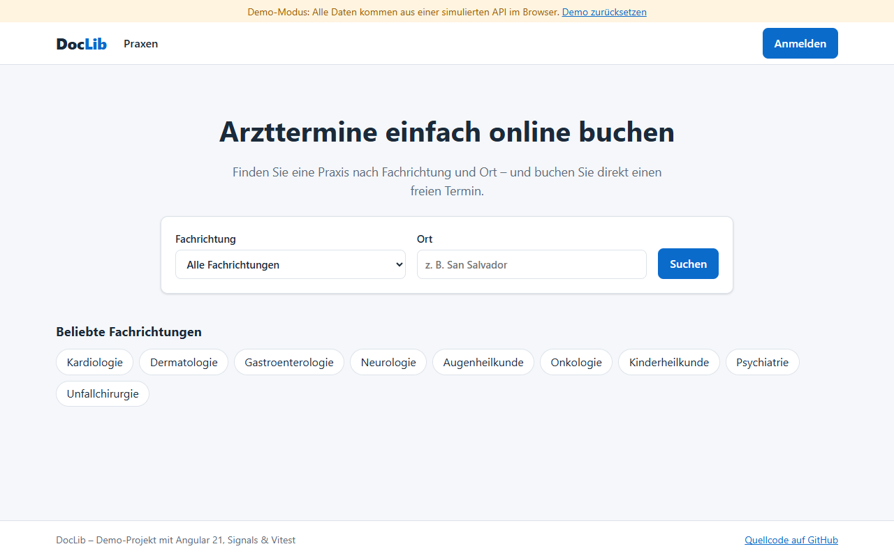
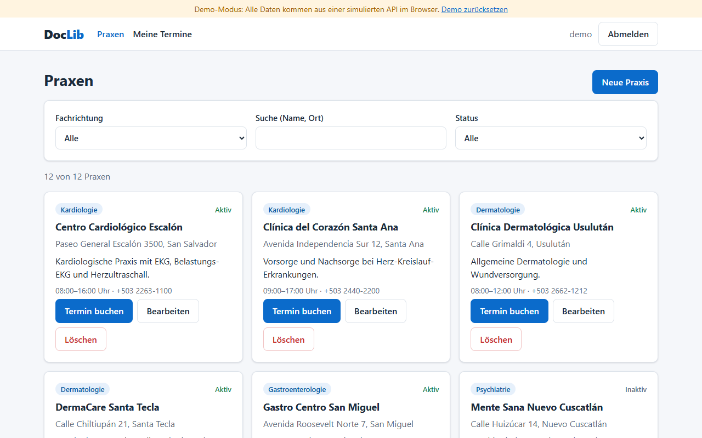
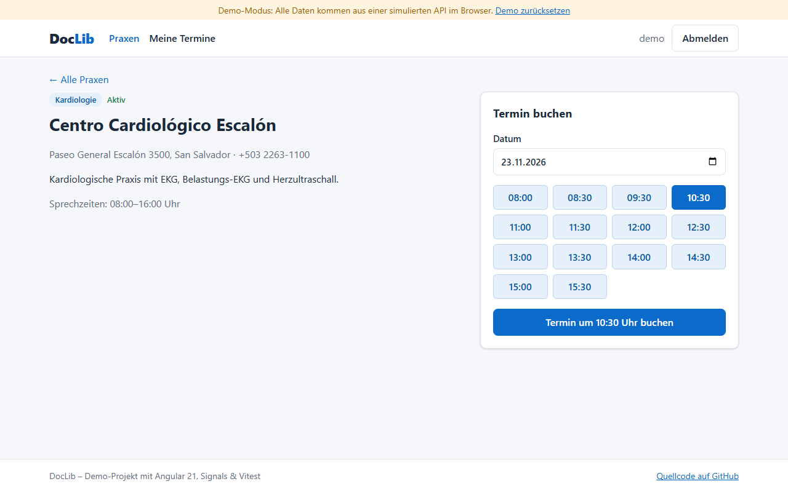
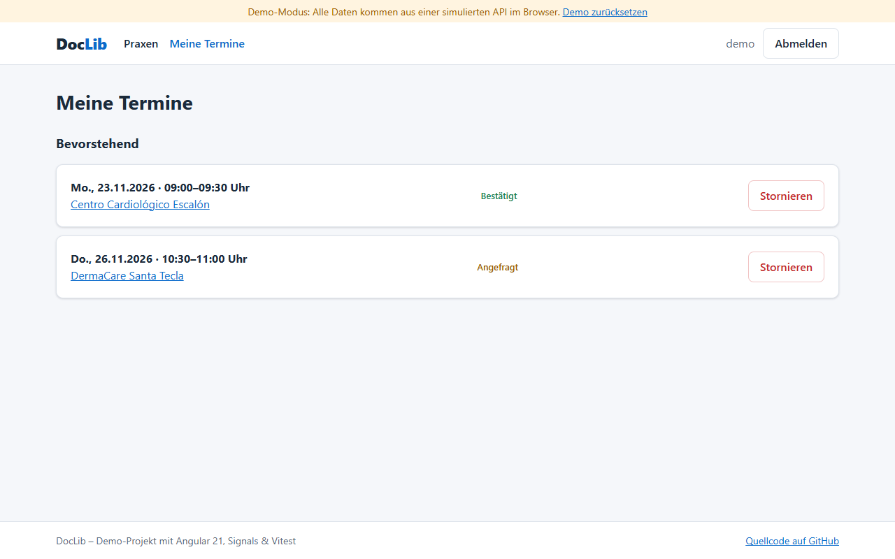

# DocLib – Online Doctor Appointment Booking (Angular 21 Demo)

[](https://github.com/gilo2754/DocLib_GUI/actions/workflows/ci.yml)

**Live demo:** https://gilo2754.github.io/DocLib_GUI/ – login `demo` / `demo`

DocLib is the frontend of a platform for booking doctor appointments online (inspired by Doctolib).
It started in 2023 as an Angular 7 client for my own **Spring Boot backend**
([spring-boot-server](https://github.com/gilo2754/spring-boot-server)) and was fully modernized to
**Angular 21** in 2026. For the demo, the frontend is decoupled from the backend: a **simulated REST
API running in the browser** reproduces the endpoints, payloads and business rules of the Spring
Boot backend.

> The UI language is **German** (target audience); code, comments and documentation are in English.

| Home | Clinics | Booking | My appointments |
| --- | --- | --- | --- |
|  |  |  |  |

## Features

- Search by speciality and location (case- and accent-insensitive), shareable filter URLs
- Clinic details with **appointment booking**: free 30-minute slots derived from opening hours;
  booked and past slots are hidden
- "My appointments" with cancellation
- Clinic management (create, edit, delete) with typed reactive forms and validation
  (e.g. opening before closing time, lengths matching the backend's `@Size(max = 200)`)
- HTTP Basic login, route guard with `returnUrl` (protected against open redirects)
- Responsive layout without a UI framework, accessible forms (labels, `role="alert"`, focus styles)

## Tech stack & architecture

| Topic | Implementation |
| --- | --- |
| Framework | Angular 21, standalone components, **zoneless** change detection, `OnPush` everywhere |
| State | **Signals** (`signal`, `computed`, `linkedSignal`, `input()`), RxJS for HTTP |
| Routing | Lazy loading per feature, functional `authGuard`, `withComponentInputBinding` |
| HTTP | Functional interceptors: `authInterceptor` + `mockBackendInterceptor` |
| Forms | Typed reactive forms, cross-field validator |
| Testing | **Vitest** (unit/integration, 71 tests, ~90% coverage) + **Playwright** (E2E, desktop & mobile) |
| Quality | angular-eslint (incl. OnPush rule), Prettier, TypeScript `strict` + `strictTemplates` |
| CI/CD | GitHub Actions: lint → format → unit → build → E2E → deploy to GitHub Pages |

```
src/app
├── core
│   ├── api/            API_CONFIG (base URLs as an InjectionToken)
│   ├── auth/           AuthService (signals), authGuard, authInterceptor
│   ├── mock-api/       Simulated REST API: MockDb (plain TS) + HTTP interceptor + seed data
│   ├── models/         Types matching the backend JPA entities (Clinic, Appointment, Speciality)
│   └── services/       ClinicService, AppointmentService, SpecialityService (REST clients)
├── features            Lazy-loaded pages: home, login, clinics, appointments, not-found
├── layout              Header (incl. demo notice), footer
└── shared              Label pipes, mapping of HTTP errors to user messages
```

### Simulated API (mock backend)

`core/mock-api/mock-backend.interceptor.ts` is the **last** interceptor in the chain. It only
answers requests to the configured API URLs; everything else passes through unchanged. Components
and services are unaware of the mock: they call exactly the same endpoints as against the real
backend.

| Method | Endpoint | Backend counterpart |
| --- | --- | --- |
| GET | `/api/v1/login` (Basic auth) | Spring Security |
| GET | `/api/v1/clinic?Speciality=…` | `ClinicController#getClinicsBySpecialty` |
| GET/PUT/DELETE | `/api/v1/clinic/{id}` | `ClinicController` |
| POST | `/api/v1/clinic/add` | `ClinicController#createClinic` |
| GET | `/admin/api/v1/specialities` | Admin API |
| GET | `/api/v1/appointment/person` · `/appointment/clinic/{id}` | `AppointmentController` |
| POST | `/api/v1/appointment/create` | `AppointmentController#createAppointment` |
| DELETE | `/api/v1/appointment/{id}` | `AppointmentController` |

Reproduced rules: 401 without valid credentials, 404 for unknown ids, **400 when deleting a clinic
that still has appointments** (like the backend's `DataIntegrityViolationException`), 409 on double
booking. Data is persisted in `localStorage`; artificial latency makes loading states visible.
"Demo zurücksetzen" (reset demo) restores the seed data.

**Using the real backend:** set `useMockApi: false` in `src/environments/environment.ts` and point
`apiUrl` to the Spring Boot server (default: `http://localhost:8081/api/v1`).

## Development

Requirements: Node.js ≥ 20.19 (or 22.12+).

```bash
npm install
npm start               # http://localhost:4200 (dev server, simulated API)
npm test                # Vitest in watch mode
npm run test:ci         # single run incl. coverage report (coverage/)
npm run lint            # angular-eslint
npm run format          # Prettier
npm run build:pages     # production build with base href /DocLib_GUI/
npm run e2e             # Playwright against the production build (run build:pages first)
npm run serve:dist      # production build served like GitHub Pages: http://localhost:4300/DocLib_GUI/
```

Demo accounts: `demo` / `demo` and `admin` / `admin`.

## Testing strategy

- **Pure logic without Angular** (slot calculation, filtering, MockDb): fast, deterministic unit tests
- **Integration**: real services and interceptors against the in-memory MockDb (the exact demo stack)
- **Components**: `TestBed` / `RouterTestingHarness`, interacting through the DOM (`data-testid`)
- **E2E**: Playwright against the production build, including deep links (SPA fallback on GitHub
  Pages) and complete flows (book → my appointments → cancel; create → edit → delete clinic)

## History

The original Angular 7 version (NgModules, TSLint, Karma/Protractor, Bootstrap via CDN) is kept in
the Git history. The migration replaces it with standalone components, signals, functional guards
and interceptors, Vitest/Playwright and ESLint.
